# BlihOps V1 User Flows

## 1. Purpose and Notation

This document describes how V1 users complete the main product journeys. It
focuses on navigation, decisions, handoffs, and outcomes. Detailed field rules
belong in feature specifications; screen states belong in the Screen Inventory.

```text
Action → Next action
[Decision?] → Branch
(System) → Automated action
```

## 2. Lifecycle Overviews

### 2.1 Company and Client Lifecycle

```mermaid
flowchart LR
    A["Qualified Lead"] --> B["Admin creates Company + Client Account"]
    B --> C["Invitation sent"]
    C --> D["Client accepts invitation"]
    D --> E["Client Account ACTIVE"]
    E --> F["Company PILOT_PREPARATION"]
    F --> G["Pilot Request"]
    G --> H["Admin review"]
    H --> I["Pilot PLANNED"]
    I --> J["Admin starts Pilot"]
    J --> K["Company ON_PILOT"]
    K --> L["Pilot COMPLETED"]
    L --> M["ACTIVE or ARCHIVED"]
```



There is no Workspace creation step. `/client-workspace` is a Company-scoped
Web experience resolved from the authenticated Client Account.

### 2.2 Pilot Eligibility

```text
Company=PILOT_PREPARATION
→ Client may submit Pilot Request
→ [Rejected] → Edit and resubmit
→ [Approved] → Pilot PLANNED
→ [Started] → Company ON_PILOT
→ [Cancelled] → Company PILOT_PREPARATION; opportunity remains
→ [Completed] → Company PILOT_COMPLETED; opportunity used
→ Admin chooses ACTIVE or ARCHIVED
```

Only a completed Pilot consumes the one free Pilot opportunity.

## 3. Flow Catalogue

| ID | Main flow | Primary actor |
|---|---|---|
| AUTH-01 | Web login and Company-scoped redirect | Client or Talent |
| AUTH-02 | Accept account invitation | Client or Talent |
| AUTH-03 | Reset password or recover access | Protected user |
| AUTH-04 | Admin login | Admin |
| PUBLIC-01 | Submit Contact inquiry | Prospective Client |
| PUBLIC-02 | Submit public Pilot request or book a call | Prospective Client |
| PUBLIC-03a | Apply to Talent Pool Round 1 | Candidate |
| PUBLIC-03b | Complete Talent Profile Round 2 | Candidate |
| ADMIN-01 | Convert Lead into Company and invite Client | Admin |
| ADMIN-02 | Manage Company, Client Account, and access | Admin |
| ADMIN-03 | Review and assess Talent Application | Admin |
| ADMIN-04 | Request completion, create Profile, and invite Talent | Admin |
| ADMIN-05 | Review Interview Requests and manage Pilot | Admin |
| ADMIN-06 | Manage structured content | Admin |
| ADMIN-07 | Manage email and Cal.com settings | Admin |
| CLIENT-01 | Enter and review Client Work | Client |
| CLIENT-02 | Discover and review Talent | Client |
| CLIENT-03 | Create and manage private Pod | Client |
| CLIENT-04 | Request individual or Pod interviews | Client |
| CLIENT-05 | Submit and track Pilot Request | Client |
| CLIENT-06 | Monitor active/completed Pilot and submit updates | Client |
| TALENT-01 | View and update Talent Profile | Talent |

## 4. Shared Authentication Flows

### AUTH-01 — Web Login and Company-Scoped Redirect

```text
Client opens shared Web login
→ Enter credentials
→ System validates credentials and account status
→ [Valid Client + Company available] → /client-workspace
→ [Deactivated Client] → blocked access state
→ [Archived Company] → unavailable Company state
→ [Valid Talent] → Talent Profile Management
```

The Client does not select or submit a Company ID. The API resolves it through
ClientAccount.

### AUTH-02 — Accept Account Invitation

```text
Client opens /accept-invitation link
→ System validates single-use unexpired token
→ Client creates password
→ System activates ClientAccount
→ System consumes invitation
→ Redirect to /client-workspace
```

An invalid, expired, or consumed token shows a link-status state. Admin can resend
or replace the invitation.

### AUTH-03 — Password Reset and Access Recovery

```text
Open Forgot Password
→ Enter email
→ Submit
→ Neutral confirmation
→ Open reset link
→ Set password
→ Token consumed
→ Return to login
```

The reset flow does not reveal whether an email exists.

### AUTH-04 — Admin Login

```text
Admin opens Admin login
→ Enter credentials
→ System validates provisioned Admin account
→ Admin Dashboard
```

## 5. Admin Flows

### ADMIN-01 — Convert Lead and Invite Client

```text
Admin opens qualified Lead
→ Review Lead details
→ Choose Convert to Company
→ System checks duplicate Company rules
→ Confirm Company and Client representative fields
→ System creates Company(PILOT_PREPARATION)
→ System creates User(role=CLIENT)
→ System creates ClientAccount(PENDING_INVITATION)
→ System records invitation lifecycle
→ System sends invitation email
→ Lead becomes CONVERTED
→ Open Company Detail
```

No Workspace record is created. The Client Workspace experience later resolves
from the ClientAccount Company ID.

### ADMIN-02 — Manage Company and Client Access

```text
Companies
→ Open Company Detail
→ Review Company status and Client Account status separately
→ Review derived Workspace access state
→ [Invite pending] → Resend or replace invitation
→ [Client needs access revoked] → Deactivate Client Account
→ [Relationship closed] → Archive Company
→ [Restoration] → Restore Company; separately reactivate Client if needed
```

Archiving preserves history and blocks Workspace access. Deactivation revokes
Client login and sessions without changing Company relationship status.

### ADMIN-03 — Review and Assess Talent Application

```text
Talent Applications
→ Open application
→ Review candidate data and resume
→ Record notes and assessment outcomes
→ Advance valid stages or reject with reason
→ Approve when requirements are met
→ Request remaining completion information
```

Only an approved application with submitted completion data can create a Talent
Profile and account.

### ADMIN-04 — Create and Invite Talent

```text
Approved Application
→ Send profile completion request
→ Candidate submits Round 2 data
→ Review combined application data
→ Create Talent Profile and account
→ Set visibility/lifecycle state
→ Send Talent invitation
→ Track activation
```

### ADMIN-05 — Review Interviews and Manage Pilot

```text
Company Detail
→ Review individual Interview Requests
→ Check availability and contact Talent manually
→ Schedule, reject, complete, or cancel requests
→ Review Client Pilot Request
→ Mark request IN_REVIEW
→ [Reject] → Client edits and resubmits
→ [Approve] → Create Pilot PLANNED
→ Confirm actual details and participants
→ Start Pilot
→ Pilot ACTIVE; Company ON_PILOT
→ Manage official information and participants
→ Review Client progress updates
→ Scheduled job completes Pilot after 14 days
→ Company PILOT_COMPLETED
→ Mark Company ACTIVE or ARCHIVED
```

A completed interview does not create a Pilot automatically. Admin is the final
decision-maker for Pilot approval and start.

### ADMIN-06 — Manage Structured Website Content

```text
Content
→ Choose content type
→ Create or edit
→ Validate localized/shared fields
→ Save draft or activate/publish
→ Record activity
```

Destructive deletion requires confirmation. Bilingual publication rules remain
defined by the content feature documents and PRD.

### ADMIN-07 — Manage Email and Cal.com Settings

```text
Settings
→ Email Templates or Cal.com
→ Review configuration
→ Edit and validate email variables or inspect integration
→ Save
```

Sensitive credentials are never shown in full.

## 6. Client Workspace Flows

### CLIENT-01 — Enter and Review Work

```text
Client activates or logs in
→ /client-workspace
→ API resolves ClientAccount.companyId
→ [PILOT_PREPARATION] → Show preparation state and Pilot Request action
→ [Request submitted/in review] → Show request state
→ [Pilot planned] → Show planned read-only details
→ [ON_PILOT] → Show active Pilot Work
→ [PILOT_COMPLETED] → Show completed Pilot card and read-only history
→ [ACTIVE] → Show Active partnership stats and Pilot history
→ [ARCHIVED] → Show unavailable Company state
```

### CLIENT-02 — Discover and Review Talent

```text
Talents
→ Search/filter/sort/paginate
→ Open Talent Detail
→ Review client-visible fields and selling rate
→ Add to private Pod or request interview
```

Hidden or archived Talent is unavailable. The Client cannot see internal rates,
assessments, notes, or margin.

### CLIENT-03 — Create and Manage Private Pod

```text
Pods
→ Create title and optional description
→ Add visible Talent
→ Optionally assign current member as Pod Lead
→ Rename, update, remove members, or archive
→ [Request interviews] → Create individual grouped requests
→ [Use for Pilot] → Expand current members into Pilot participants
```

Admin cannot see Pod content. Pod changes do not change existing requests or
Pilot participant snapshots.

### CLIENT-04 — Request Individual or Pod Interviews

```text
Open Talent Detail
→ Request Interview
→ Add optional context
→ Submit
→ Request PENDING
```

Or:

```text
Open private Pod
→ Request Interviews for Pod
→ System creates one request per current member
→ Client sees individual requests grouped by the action
```

Admin coordinates availability and scheduling. Interview completion is optional
for Pilot participation.

### CLIENT-05 — Submit and Track Pilot Request

```text
Work in PILOT_PREPARATION
→ Submit Pilot Request
→ Enter title, goals, success measurements, expected start date, context
→ Select individual Talent and/or private Pods
→ System expands Pod members and removes duplicates
→ Request SUBMITTED
→ Admin reviews
→ [Rejected] → Client edits and resubmits
→ [Approved] → Planned Pilot appears
```

The duration is fixed at 14 days. The Client cannot start the Pilot.

### CLIENT-06 — Monitor Pilot and Submit Updates

```text
Pilot becomes ACTIVE
→ Client views title, status, dates, goals, measurements, participants
→ Client submits text-only progress update
→ System assigns author and timestamp
→ Update becomes permanent
```

The Client cannot edit/delete updates or change official Pilot data. After
completion, the Client can view the Pilot read-only but cannot submit updates.

## 7. Talent Flow

### TALENT-01 — View and Update Talent Profile

```text
Talent accepts invitation
→ Profile Management
→ Edit permitted fields
→ Submit
→ System validates and saves
→ Show success or actionable error
```

Archived Profiles cannot be edited. Talent cannot edit Admin-managed fields.

## 8. Shared Interaction Patterns

- Validate before mutation and preserve valid input on failure.
- Prevent duplicate submission while a mutation is processing.
- Show truthful success only after the server confirms the mutation.
- Confirm archive, cancellation, and Admin removal actions.
- Enforce role, ownership, account, and Company status on the server.
- Keep internal audit separate from the Client activity projection.
- Send essential access emails only; no general operational notifications in V1.
